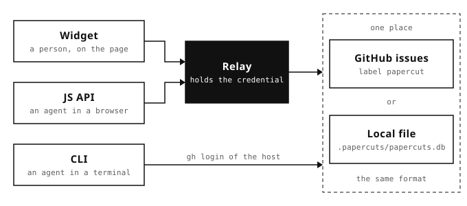
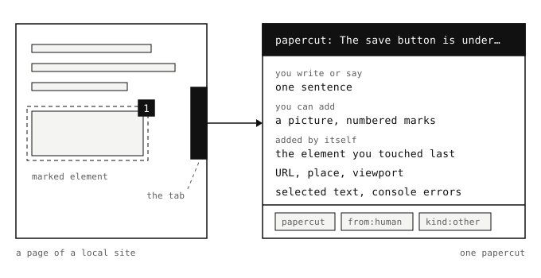
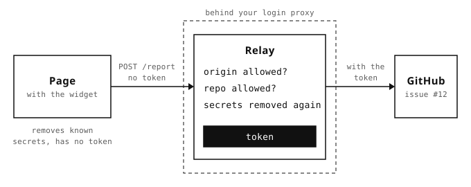
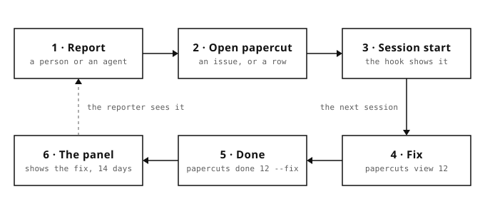
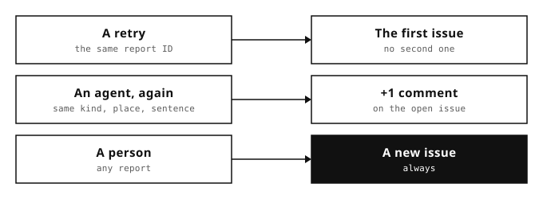
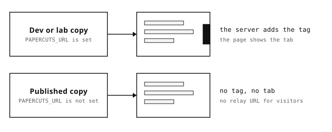

# Papercuts, shown

This guide shows how papercuts works and why it is built this way, one picture at a time. It takes about five minutes. The [README](README.md) is the reference: every option, every command, every route.

## The idea

Small problems get lost. A button overlaps on the phone. A tool prints output that an agent cannot use. A rule in `AGENTS.md` points to a file that moved. Each one costs a few minutes, again and again, and nobody writes it down because writing it down costs more than the problem.

Papercuts makes the report cheaper than the problem. A person says one sentence on the page. An agent runs one command. Both reports land in the same place, in the same format, and the agent that picks up the work reads them all the same way.

Papercuts is for local sites: dev and review copies on your own machine or home lab. It is not a feedback widget for public visitors.

## Three ways in, one place



There are three ways to report, because there are three places where friction shows:

- **Widget.** A tab on the edge of a page, for a person who looks at the site.
- **JS API.** `papercuts.report()` on the same page, for an agent that drives a browser. It does not need to click the tab.
- **CLI.** `papercuts add tool "..."`, for an agent in a terminal.

The widget and the JS API run in a browser, so they send their report to the **relay**, a small server. The CLI runs on your machine and uses the `gh` login of the host, or a token file.

All three write to one store. The default store is GitHub: each papercut is an issue with the label `papercut` in the repo of the project. The other store is local: each papercut is a row in `.papercuts/papercuts.db`, a gitignored SQLite file of the repo. The local store needs no GitHub account, no credential and no network. The commands are the same for both.

**Why one place?** An agent that starts work should not have to look in three inboxes with three formats. One list and one format mean that the same few commands work in every repo.

## What one report carries



A person gives one input, by voice or by text, and presses Send. That is the whole form.

Everything else comes along in the background: the element that you touched last, the URL, the place, the viewport, the selected text and the console errors. If one sentence is not enough, "Mark" adds numbered elements, boxes around regions, and drawings on a picture of the page.

**Why so little?** A form with a kind, a severity and five fields gets skipped. People only give feedback, and agents do the triage. So a report from the widget has the kind `other`, unless a quick phrase sets one. Agents choose a kind when they report: `bug`, `ux`, `copy`, `tool`, `rule`, `path`, `idea` or `other`.

**Why the context?** The agent that fixes the papercut was not there. With the element, the place and the viewport it can open the same page in the same state: `papercuts replay <id>` does that and frames the element.

## The token stays on the relay



To create an issue, something must hold a GitHub credential. A page must not: every script on the page could read it. So the relay holds the credential, serves the widget, and creates the issues. The browser never sees a token.

The relay is careful about what it accepts:

- It takes reports only from the origins that you allow, and only for the repos that you allow.
- Papercuts replaces known secret patterns with `[redacted]` before a report leaves the browser, and the relay does it again. This catches common mistakes. It does not find every secret.
- The relay has no login of its own. Run it behind your login proxy. The widget sends only simple requests, so the proxy can stay in front of every route.

With the local store there is no credential at all: the relay writes to the SQLite file and listens on `127.0.0.1`.

## From a report to a fix



A report is only useful if somebody reads it at the right moment. That moment is the start of work.

1. A person or an agent reports.
2. The papercut is open: an issue, or a row in the local file.
3. `papercuts setup` installs a session-start hook for Claude Code and Codex. At the start of each agent session, the hook shows the open papercuts of the current repo, and nothing when there are none.
4. The agent reads one with `papercuts view <id>` and fixes it with the rules of the repo.
5. The agent closes it with `papercuts done <id> --fix "<what changed>"`.
6. The panel on the page lists the open papercuts with their replies, and the ones fixed in the last 14 days with the fix note. So the person who reported sees what happened.

If a papercut needs a decision, the agent does not close it. It writes two or three options with `papercuts comment <id>`, and the answer comes back in the same thread.

**Why a fix note?** A closed issue says that something happened. The fix note says what, in one sentence, where the reporter looks anyway.

## Repeats



Agents repeat themselves. Ten sessions hit the same broken tool, and ten issues would bury the list. So papercuts treats three cases differently:

- **A retry.** Each report has an ID. A report with an ID that exists already returns the first issue, so a retry never makes a second one.
- **An agent, again.** A report from an agent with the same kind, place and sentence as an open papercut adds a `+1` comment to that issue. The count shows how often the problem costs time.
- **A person.** A report from a person always opens a new issue. Two people who write the same sentence may mean two different things.

## Only where a relay exists



The widget is one script tag. The server adds it to the page only when the environment variable `PAPERCUTS_URL` is set, and you set it only for the copies that have a relay.

**Why not put the tag into the page itself?** A published copy has no relay, and the tag would show the relay URL to every visitor. Each app therefore keeps a test: without `PAPERCUTS_URL` the page has no `papercuts`, with it the page has exactly one tag. If the relay does not answer, the page shows no tab.

## Try it

The shortest path uses the local store, with no account and no credential. Run this in the repo of an app:

```sh
npx github:Tim-Conrad/papercuts init --store local
npx github:Tim-Conrad/papercuts add tool "the test runner hides the failing line" --where "npm test"
npx github:Tim-Conrad/papercuts
```

The last command lists the open papercuts. For the widget, start a relay in the same folder with `PORT=8787 npx github:Tim-Conrad/papercuts serve`, and let your dev server add this tag to the `<head>`:

```html
<script src="http://localhost:8787/papercuts.js" data-repo="owner/name"></script>
```

## Go deeper

- [Integrate papercuts into an app](README.md#integrate-papercuts-into-an-app): the checklist, in order.
- [Where papercuts go](README.md#where-papercuts-go): GitHub or local, per project or one central inbox.
- [The ticket config](README.md#the-ticket-config): kinds, fields, quick phrases and labels of an app.
- [Run the relay](README.md#run-the-relay): settings, routes and the home lab setup.
- [Issue format](README.md#issue-format) and [Security](README.md#security).
